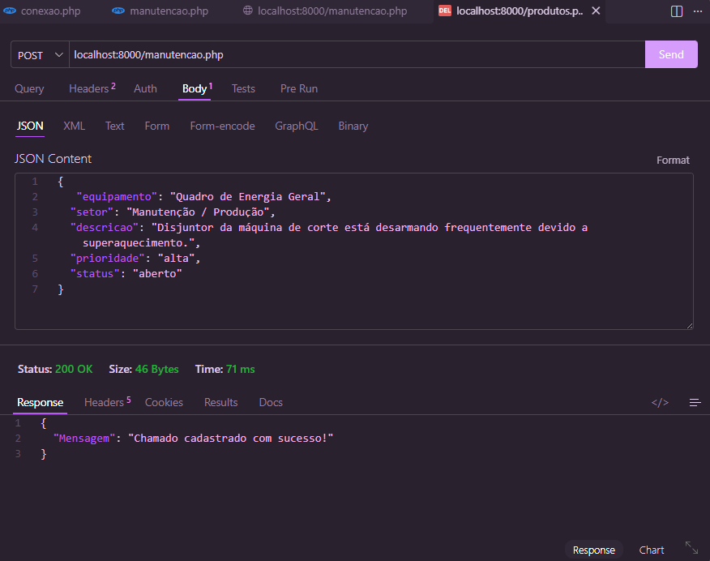
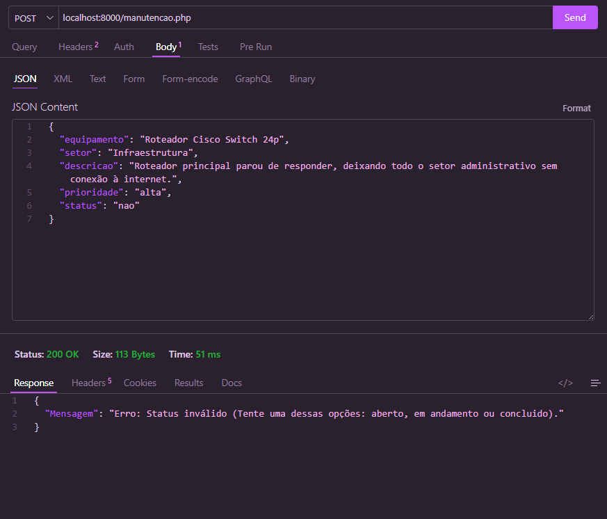
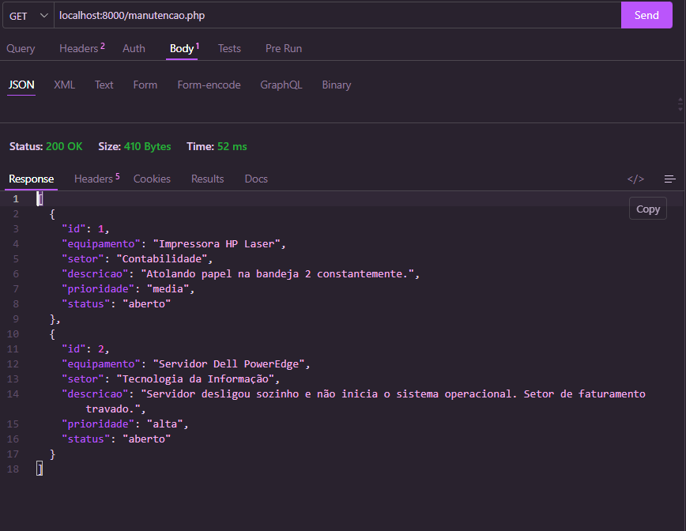
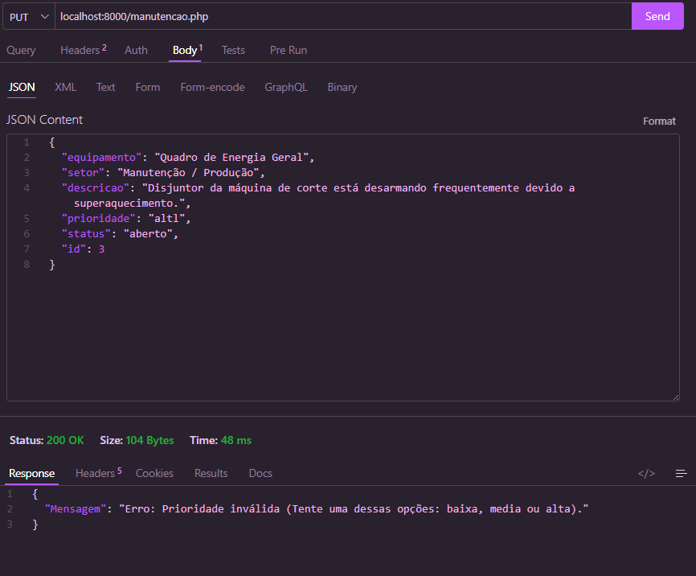
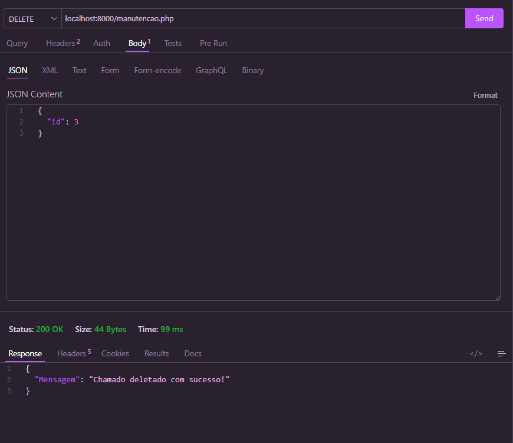
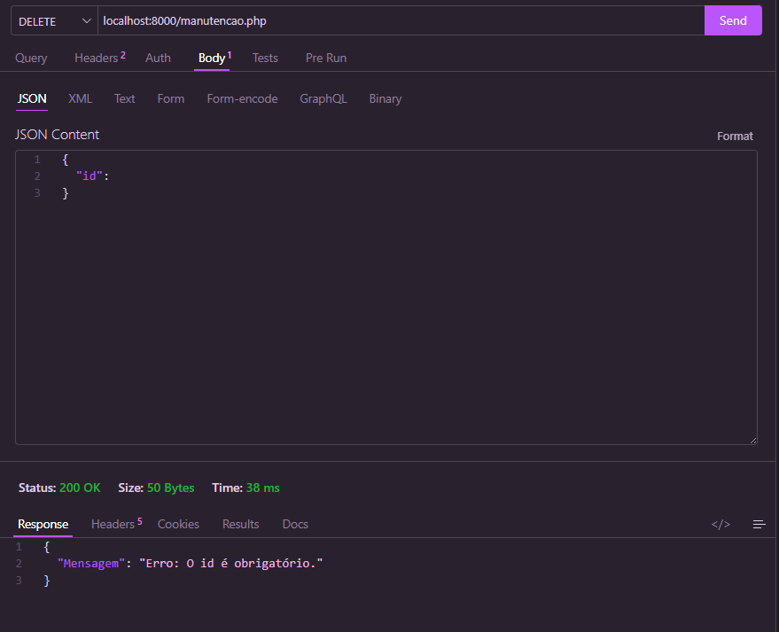

# 🛠️ API para Controle de Chamados de Manutenção

Esta é uma API REST desenvolvida em **PHP** utilizando **PDO** para o gerenciamento e controle de chamados de manutenção de equipamentos. O objetivo do projeto é substituir anotações manuais e mensagens soltas por um sistema centralizado, permitindo registrar, listar, atualizar e excluir chamados de forma organizada.

## 🚀 Funcionalidades (CRUD)
* **Cadastrar (POST):** Registra um novo chamado após validar os dados obrigatórios e os valores de prioridade/status.
* **Listar (GET):** Retorna todos os chamados salvos no banco de dados ordenados por ID.
* **Atualizar (PUT):** Altera as informações de um chamado existente com base no ID fornecido.
* **Excluir (DELETE):** Remove um chamado do sistema utilizando o seu ID.

---

## 🗄️ Estrutura do Banco de Dados

A API interage com a tabela `chamados`. Certifique-se de executar o comando abaixo no seu gerenciador de banco de dados para criar a tabela necessária:

```sql
CREATE TABLE chamados (
    id SERIAL PRIMARY KEY,
    equipamento VARCHAR(50) NOT NULL,
    setor VARCHAR(50) NOT NULL,
    descricao VARCHAR(350) NOT NULL,
    prioridade VARCHAR(5) NOT NULL, -- Valores aceitos: baixa, media, alta
    status VARCHAR(13) NOT NULL     -- Valores aceitos: aberto, em andamento, concluido
);
```

---

## ⚙️ Regras de Validação do Negócio

A API possui escudos de validação rigorosos usando `exit;` para interromper requisições incorretas imediatamente:
1. **Campos Obrigatórios:** Em rotas de criação e edição, a ausência de qualquer campo bloqueia a operação.
2. **Controle de Prioridade:** Só são aceitos estritamente os valores em minúsculo: `baixa`, `media` ou `alta`.
3. **Controle de Status:** Só são aceitos estritamente os valores em minúsculo: `aberto`, `em andamento` ou `concluido`.

---

## 📮 Como Testar as Rotas da API

Todas as requisições que enviam dados para a API (POST, PUT e DELETE) devem utilizar o formato **JSON** e o cabeçalho `Content-Type: application/json`.

### 1. Cadastrar Chamado (`POST`)
* **URL:** `http://localhost/seu-projeto/manutencao.php`
* **Corpo do JSON (Payload):**
```json
{
  "equipamento": "Impressora HP Laser",
  "setor": "Financeiro",
  "descricao": "Impressora atolando papel na bandeja traseira.",
  "prioridade": "media",
  "status": "aberto"
}
```
* **Resposta de Sucesso:**
```json
{
  "Mensagem": "Chamado cadastrado com sucesso!"
}
```
ex: | ex: com status inválido 

### 2. Listar Chamados (`GET`)
* **URL:** `http://localhost/seu-projeto/manutencao.php`
* **Resposta Esperada:**
```json
[
  {
    "id": 1,
    "equipamento": "Impressora HP Laser",
    "setor": "Financeiro",
    "descricao": "Impressora atolando papel na bandeja traseira.",
    "prioridade": "media",
    "status": "aberto"
  }
]
```
ex: 

### 3. Atualizar Chamado (`PUT`)
* **URL:** `http://localhost/seu-projeto/manutencao.php`
* **Corpo do JSON (Payload):** *(O campo `id` é obrigatório para localizar o registro)*
```json
{
  "id": 1,
  "equipamento": "Impressora HP Laser",
  "setor": "Financeiro",
  "descricao": "Impressora reparada após troca de roletes.",
  "prioridade": "baixa",
  "status": "concluido"
}
```
* **Resposta de Sucesso:**
```json
{
  "Mensagem": "Chamado atualizado com sucesso!"
}
```
ex: com prioridade invalida 
### 4. Deletar Chamado (`DELETE`)
* **URL:** `http://localhost/seu-projeto/manutencao.php`
* **Corpo do JSON (Payload):**
```json
{
  "id": 1
}
```
* **Resposta de Sucesso:**
```json
{
  "Mensagem": "Chamado deletado com sucesso!"
}
```
ex:  | ex: com id vazio 
---

## 🛠️ Tecnologias Utilizadas
* **PHP 8.x** (Estrutura lógica e roteamento)
* **PDO (PHP Data Objects)** (Conexão e execução segura de queries com prepared statements)
* **JSON** (Padrão para tráfego e resposta de dados)

## 🔍 Erros Descobertos e Como Foram Resolvidos (Post-Mortem)

Durante o desenvolvimento e a fase de testes automatizados da API, deparamos-nos com alguns comportamentos inesperados do PHP e do PDO. Abaixo estão listados os problemas encontrados e as soluções aplicadas:

### 1. Mensagens de Sucesso Duplicadas e Erros de Banco após Respostas de Erro
*   **Problema:** Quando um campo obrigatório vinha vazio ou com valores inválidos (como `prioridade: "URGENTE"`), a API retornava o JSON de erro correspondente, mas continuava executando as linhas de baixo, tentando inserir ou deletar dados incorretos no banco de dados.
*   **Como foi resolvido:** Adicionamos o comando **`exit;`** logo após cada `echo json_encode()`. O `exit;` funciona como um escudo protetor, interrompendo o script PHP imediatamente e garantindo que o banco de dados só seja tocado se todas as validações forem aceitas.

### 2. Erro `Uncaught PDOException: Invalid text representation` (Parâmetro Inteiro Rejeitando Texto)
*   **Problema:** Ao testar a rota `PUT`, o PHP gerava um erro fatal alegando que o banco de dados esperava receber um número inteiro (o `id`), mas estava recebendo o texto do status (`"aberto"`).
*   **Como foi resolvido:** Identificamos que a ordem das variáveis passadas dentro do array do `$comando->execute([...])` estava desalinhada com as interrogações `?` do comando SQL `UPDATE`. Como a cláusula `WHERE id = ?` está no final da query, ajustamos o array para que o `$dados["id"]` passasse a ser **obrigatoriamente o último elemento da lista**, casando perfeitamente a posição de cada dado enviado com a sua respectiva coluna.

### 3. Falsos Positivos de "Campos Vazios" no método PUT
*   **Problema:** Ao testar a rota `PUT`, a API barrava a requisição afirmando que havia campos vazios, mesmo com o JSON totalmente preenchido.
*   **Como foi resolvido:** Identificamos que o erro era puramente de digitação na linha do `if`. A palavra-chave `empty()` foi esquecida antes da variável `$dados['equipamento']`, ficando apenas `|| ($dados['equipamento']) ||`. Como o campo continha o texto do equipamento, o PHP interpretava essa string solta como um valor verdadeiro (`true`), ativando o erro de campo vazio incorretamente. A correção consistiu em adicionar o `empty()` que faltava na validação daquela variável.
